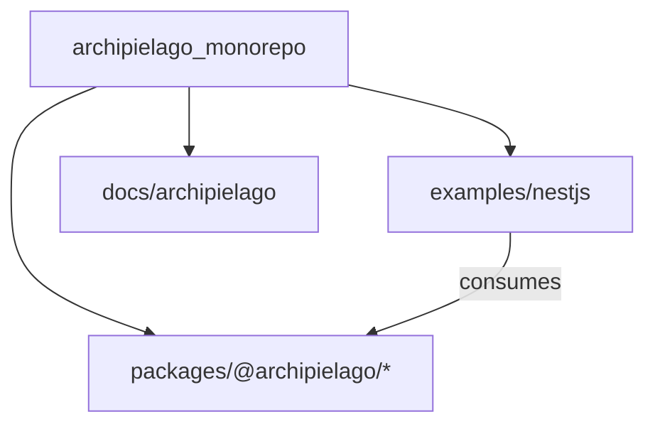

# Docs: Archipielago product-repo framing

## Goal

After Phase 2 ([ADR-0032](docs/adr/0032-archipielago-pnpm-monorepo.md)), the GitHub repo is `archipielago` and the product identity already lives under [`docs/archipielago/`](docs/archipielago/README.md). The root entry docs still present a Nest sample (`# sample-nestjs-project`). Update framing docs so newcomers land on **Archipielago the product**, with `examples/nestjs` as the first host example—not the product itself.

Guide docs teach **host-agnostic** install/wiring/authoring, with Nest as a **worked mapping** so readers can wire other hosts even without more `examples/*`. [`docs/how-to-web-ui.md`](docs/how-to-web-ui.md) is reframed as the Nest-example / dogfood-website cookbook (in-repo implementers and anyone copying this style)—not package-consumer docs.

**Split:** ADR-0031 plan-lifecycle polish (one workspace plan, body Todos, no CreatePlan forks, AGENTS/cloud skill/workflow updates) lives in a **separate uncommitted plan**—[`.cursor/plans/2026-11-02-plan-lifecycle-workspace-todos.md`](2026-11-02-plan-lifecycle-workspace-todos.md)—for its own later branch/PR. Do not implement that slice here.

Out of scope: implementing next roadmap phases (including scaffolder extraction), applying identifier/script renames (document as TD only), mass-editing historical ADR bodies for branding (forbidden by new ADR-0033), numbered guide filename renames (rejected—option 1), deep CONTRIBUTING rewrite, **plan-lifecycle / ADR-0031 process polish** (other plan). In scope: READMEs (incl. mission/vision/workflow links), light CONTRIBUTING → workflow pointer, guide order + `authoring.md`, how-to-web-ui reframe, **TD-034 / TD-035 / TD-036**, scaffolder **roadmap milestone text**, **ADR-0033**.

## Framing rules (apply everywhere we touch)

- **This repository** = Archipielago monorepo (engines in `packages/*`, shared tooling at root, docs source of truth in-tree).
- **`examples/nestjs`** = first runnable NestJS **host example** / reference consumer of `@archipielago/*` (and future dogfood site host)—not “the app” or “sample project.”
- Prefer **“Nest example”** over **“Nest sample”** in living docs; leave past-tense ADR history alone (ADR-0033).
- **Root README** = product identity, monorepo layout, shared workspace prereqs/install, contributor Checks, early **Examples** link to Nest runbook; early philosophy links (**mission**, **vision**, **workflow**); roadmap is a light “see current status” link, not a Phase-N banner in the lead.
- **Nest host runbook** = Database / Run / Observability in [`examples/nestjs/README.md`](examples/nestjs/README.md).
- **Package READMEs** = short stubs pointing at `docs/archipielago/` (not a second docs tree).
- **Guide chain** = concepts → install → wiring → **authoring** → nestjs (Nest = worked wiring + pointer into example how-to). Filenames stay unnumbered.
- **wiring / nestjs** = transferable host contract + one Nest mapping so other hosts are achievable without more samples.
- **authoring (new)** = host-agnostic product UI rules (island conventional shape vs freer SSR trees, props outside UI, CSS lanes).
- **how-to-web-ui** = Nest-example / website dogfood cookbook + style to replicate; not consumer install docs.

## Branch and plan file

- Branch from `main`: `docs/archipielago-product-repo-framing`
- This plan lives under [`.cursor/plans/`](.cursor/plans/) ([ADR-0031](docs/adr/0031-project-plan-files.md)). Already committed as PR starting point; **further plan iterations are commit-worthy diffs** on this same file—push to the PR until delete-before-merge (`plan-files` CI). Follow existing ADR-0031; do not expand ADR-0031 in this PR.

## File changes

### 1. Rewrite [`README.md`](README.md) (primary)

- Title: `# Archipielago`
- Lead: product definition + monorepo layout (`packages/*` + `examples/nestjs`). Present tense—what the repo **is**, not which roadmap phase just finished.
- Do **not** banner “Phase 2 done” in the lead. Roadmap status belongs in [`docs/archipielago/roadmap.md`](docs/archipielago/roadmap.md): among Documentation (or similar) links, a short invitation to see **current roadmap status** there. Mention ADR-0032 only where it clarifies package layout (e.g. why engines live under `packages/`), not as a phase headline.
- Early / Documentation links must include product philosophy, not only technical how-tos:
  - [`docs/archipielago/mission.md`](docs/archipielago/mission.md)
  - [`docs/archipielago/vision.md`](docs/archipielago/vision.md)
  - [`docs/archipielago/workflow.md`](docs/archipielago/workflow.md) (recommended AI-assisted contribution flow)
  - Also: product README, roadmap (light “current status” invite), architecture, **guide** (incl. authoring)
  - Treat how-to-web-ui as Nest-example UI cookbook, not the primary consumer path
- Keep **Prerequisites** / **Setup** / **Checks** / **Documentation** / **Agents** / **License** at root.
- Early **Examples** → [`examples/nestjs/README.md`](examples/nestjs/README.md); no Database / Run / Observability bodies at root.
- Drop `sample-nestjs-project` naming.

### 1b. Light [`CONTRIBUTING.md`](CONTRIBUTING.md) pointer

Add a short pointer to [`docs/archipielago/workflow.md`](docs/archipielago/workflow.md) (project philosophy / recommended contribution flow)—e.g. near the top after the title or under Git workflow. Do **not** skip workflow on the root README; CONTRIBUTING is an additional home for contributors who land there first. No deep CONTRIBUTING rewrite.

### 2. Add [`examples/nestjs/README.md`](examples/nestjs/README.md)

Nest host runbook: lead, Database, Run (note TD-034), Observability; link root for shared setup/checks; link how-to-web-ui for example UI authoring / scaffold; link guide for product wiring.

### 3. Package README stubs

Short READMEs under [`packages/core`](packages/core/), [`packages/react`](packages/react/), [`packages/vite`](packages/vite/), [`packages/nestjs`](packages/nestjs/): role + links into `docs/archipielago/` (nestjs package → `guide/nestjs.md` + guide home).

### 4. Guide reading order + landing

Order: **concepts → install → wiring → authoring → nestjs** (no filename renames).

- [`docs/archipielago/README.md`](docs/archipielago/README.md): start-here / reading order; add authoring row to the doc table; clarify nestjs row = worked host mapping; how-to-web-ui = example/dogfood cookbook (separate from guide).
- Add [`docs/archipielago/guide/README.md`](docs/archipielago/guide/README.md): same order, one-line purpose each; link mission/vision/roadmap via product README.

### 5. Add [`docs/archipielago/guide/authoring.md`](docs/archipielago/guide/authoring.md)

New host-agnostic authoring page (portable rules for any host’s product UI tree):

- When SSR page / server child vs island (interactivity boundary).
- Island conventional shape (`ui/islands/<name>/…`, manifest/registration)—stricter; pages/server-components freer but still host-owned product trees.
- Page embed props live outside UI modules (protocol-style contract); islands use component props / markers.
- CSS lanes at product-policy level (shell vs sibling vs island module)—point at ADRs, do not Nest-lock paths.
- Point to [`guide/nestjs.md`](docs/archipielago/guide/nestjs.md) + [`how-to-web-ui.md`](docs/how-to-web-ui.md) for the Nest example’s concrete folders, scaffold, and dogfood style.

Do not dump the full Nest cookbook into authoring.md.

### 6. Reframe [`docs/how-to-web-ui.md`](docs/how-to-web-ui.md)

Audience/lead rewrite only as needed (keep decision tree and steps):

- This doc is for developing UI in **`examples/nestjs`** (Nest host example / future dogfood site) and for anyone who wants to **replicate this implementation style**.
- Not the primary guide for installing/using `@archipielago/*` in an arbitrary host—that is `docs/archipielago/guide/`.
- Fix leftover “this Nest + islands app” / “sample” wording; keep `examples/nestjs` paths.
- Note scaffold stays example-local for now (TD-035).

Update inbound pointers lightly: [`guide/nestjs.md`](docs/archipielago/guide/nestjs.md) Authoring section, AGENTS §8 if it oversells how-to as product-consumer docs, architecture “how to add UI” link context.

### 7. Present-tense product docs

- [`docs/archipielago/vision.md`](docs/archipielago/vision.md): present-tense monorepo (Phase 2 done); public site / more hosts remain future.
- [`docs/archipielago/roadmap.md`](docs/archipielago/roadmap.md): “Nest example” wording in living Phase 2/3 bullets; Done status unchanged; **plus** scaffolder milestone in §10 (with TD-035).
- Product README: any remaining pre-monorepo tense plus §4 order/table updates.

### 8. Current-state map — [`docs/architecture.md`](docs/architecture.md)

Short intro: maps **today’s Nest host example** + package layout; host-agnostic model under `docs/archipielago/guide/`; example owns API/pages under `examples/nestjs`, engines are `@archipielago/*`.

Soften any “how to add UI” line so how-to-web-ui reads as example cookbook and guide/authoring as portable rules. Do **not** expand the **Agent plans** subsection for body Todos / CreatePlan rules here—that is the other plan.

### 9. Root package metadata

Set [`package.json`](package.json) `"description"` to a one-line Archipielago monorepo blurb. Do not rename/split root scripts or move the scaffolder.

### 10. Tech debt — [`docs/known-tech-debt.md`](docs/known-tech-debt.md)

Add three doc-only open items (next ids after TD-033). Do **not** implement the renames/extractions in this PR.

**TD-034 — Monorepo / DX (root scripts)**

| Column       | Content                                                                                                                               |
| ------------ | ------------------------------------------------------------------------------------------------------------------------------------- |
| Desired      | Root scripts host-namespaced or multi-example-safe so a second `examples/*` does not collide with bare `start` / `test` / `storybook` |
| Current      | Root scripts hard-filter `@archipielago/example-nestjs`; `build` appends that example after packages                                  |
| Why deferred | Only one host example; discovered while reframing docs—rename when a second host lands (or earlier if DX pain warrants)               |
| Spec         | Doc only                                                                                                                              |

**TD-035 — Archipielago / DX (web-ui scaffolder)**

| Column       | Content                                                                                                                                                                          |
| ------------ | -------------------------------------------------------------------------------------------------------------------------------------------------------------------------------- |
| Desired      | Scaffolder lives as its own package or under `@archipielago/nestjs` (or similar); later enough config that hosts can scaffold without obligatory Nest-example folder conventions |
| Current      | `examples/nestjs/scripts/scaffold-web-ui.ts` + root `pnpm scaffold:web-ui` filter; `create-web-ui` skill and how-to-web-ui assume that layout                                    |
| Why deferred | Tracked as an **unscheduled late roadmap milestone** (below); extraction/API design waits—near-term still useful for dogfood / replicating this example                          |
| Spec         | Doc only — link the new roadmap row/section                                                                                                                                      |

**TD-036 — Nest example / naming (leftover `sample-nestjs-*` identifiers)**

| Column       | Content                                                                                                                                                                                                                                                                                                                                                       |
| ------------ | ------------------------------------------------------------------------------------------------------------------------------------------------------------------------------------------------------------------------------------------------------------------------------------------------------------------------------------------------------------- |
| Desired      | Runtime / ops identifiers match Archipielago Nest-example naming (e.g. `archipielago-nestjs-db`, Observe `serviceId` aligned with the example—not the old sample repo title)                                                                                                                                                                                  |
| Current      | Known leftovers: Docker `container_name: sample-nestjs-db` in [`examples/nestjs/docker-compose.yml`](examples/nestjs/docker-compose.yml); NestJS Observe `serviceId: 'sample-nestjs-project'` in [`examples/nestjs/src/app.module.ts`](examples/nestjs/src/app.module.ts). Living docs drop `sample-nestjs-project` in this PR; these code/ops strings remain |
| Why deferred | Docs-only framing PR; renames can break local Compose volumes / Observe dashboards—do in a small dedicated change with a grep pass for any other `sample-nestjs*` hits                                                                                                                                                                                        |
| Spec         | Doc only                                                                                                                                                                                                                                                                                                                                                      |

**Roadmap — unscheduled / terminal milestone** in [`docs/archipielago/roadmap.md`](docs/archipielago/roadmap.md) (pairs with TD-035 only):

- Add a table row **after Phase 6** (same pattern as the unphased **Publish** row: named, status “Not started”, no calendar date)—e.g. **Author tooling** / **Configurable web-ui scaffolder**.
- Short section: extract today’s Nest-example scaffolder into a package (own package or nest under `@archipielago/nestjs`); first consumers can still target this example’s conventions; later config so other hosts are not forced into dogfood folder layout. Point at **TD-035**. Do **not** assign it to Phase 3–5 as a blocker; it may land whenever author DX warrants, preferably late (after dogfood site / second host pressure is clearer).

**Deferred-but-not-TD (intentional non-debt):**

- Numbered guide filenames—rejected in favor of docs-only reading order (option 1).
- Phase 3+ host/site work—already roadmap phases, not tech debt rows.
- Historical ADR “Nest sample” wording—**not** a rename backlog; governed by **ADR-0033** below (leave bodies alone).
- Plan-lifecycle process polish—separate plan (not TD).

### 11. ADR-0033 — Historical ADR immutability

[`docs/adr/README.md`](docs/adr/README.md) Policy already says: supersede with a new ADR; do not silently rewrite history; append a short note if correcting facts. Elevate that into a dedicated **ADR-0033** so agents and humans treat it as a binding rule—not a README tip—especially when product framing changes (e.g. “Nest sample” → “Nest example”).

**Decision to record (Accepted):**

- Accepted ADR **bodies** are historical records. Do **not** mass-edit them for branding, tone, or present-tense product framing.
- When a tradeoff changes: write a **new** ADR; set the old Status to `Superseded by ADR-…` (or “in part” / “amended by” as already practiced); optionally add a short Status/Consequences pointer—**not** a rewrite of the old Context/Decision narrative.
- Allowed on an Accepted ADR without a full supersede: factual errata (broken links, wrong path that never matched the decision), Status line updates, and thin “see ADR-NNNN” cross-links—same spirit as today’s README one-liner.
- Living docs (`architecture.md`, `docs/archipielago/**`, READMEs, how-tos) **do** get present-tense updates; that is where framing lives.
- This framing PR does **not** rewrite ADR-0029/0032 “Nest sample” language; ADR-0033 is why.

**Also update:**

- [`docs/adr/README.md`](docs/adr/README.md) — Policy bullet points at ADR-0033; index row for 0033.
- [`docs/adr/_template.md`](docs/adr/_template.md) — one-line reminder if useful (do not invent process beyond ADR-0033).
- [`AGENTS.md`](AGENTS.md) §6 — point at ADR-0033 when recording ADRs (alongside existing supersede mention). Do **not** add body-Todos / CreatePlan-fork rules here (other plan).

Next free id after ADR-0032 is **0033**.

### 12. Leave alone (implement later / never in this PR)

- Historical ADR bodies (0029/0032 “Nest sample”, etc.)—per ADR-0033.
- Guide filename numbered prefixes.
- Applying TD-034 / TD-035 / TD-036 (document only this PR).
- Deep CONTRIBUTING rewrite beyond the workflow pointer in §1b.
- ADR-0031 / AGENTS plan-iteration / cloud skill / workflow body-Todos polish—[separate plan](2026-11-02-plan-lifecycle-workspace-todos.md).

## Delivery

1. Commit this plan revision to the framing PR (does not include the separate lifecycle plan file until that PR exists).
2. Execute the file changes above; `pnpm format` on touched markdown/json if needed.
3. Commit with [create-commit skill](.agents/skills/create-commit/SKILL.md) (sensible `docs:` splits; ADR-0033 with index/AGENTS in the same slice as other ADR work).
4. Delete this plan file in a later commit before merge ([ADR-0031](docs/adr/0031-project-plan-files.md) / CI).

## Todos

- [x] `branch-plan` — Create docs/archipielago-product-repo-framing branch and save plan under .cursor/plans/ (completed)
- [ ] `readme-rewrite` — Rewrite root README—product entry, mission/vision/workflow links, light roadmap invite, Nest example runbook (pending)
- [ ] `contributing-workflow-link` — Add light CONTRIBUTING.md pointer to docs/archipielago/workflow.md (keep workflow on root README too) (pending)
- [ ] `nestjs-example-readme` — Add examples/nestjs/README.md with Nest host Database / Run / Observability onboarding (pending)
- [ ] `package-readmes` — Add short packages/{core,react,vite,nestjs}/README.md stubs pointing at docs/archipielago (pending)
- [ ] `guide-reading-order` — Guide start-here order concepts→install→wiring→authoring→nestjs (product README + guide/README.md; no renames) (pending)
- [ ] `guide-authoring` — Add docs/archipielago/guide/authoring.md host-agnostic UI authoring (island vs SSR shape) (pending)
- [ ] `how-to-web-ui-reframe` — Reframe how-to-web-ui.md as Nest-example / dogfood website cookbook (not package-consumer docs) (pending)
- [ ] `product-docs-tense` — Update vision/roadmap(/product README) to present-tense monorepo + Nest example wording (pending)
- [ ] `architecture-intro` — Add architecture.md framing: Nest example current-state vs host-agnostic guides (pending)
- [ ] `package-description` — Fill root package.json description (pending)
- [ ] `td-root-scripts` — Add TD-034: root pnpm scripts hardwired to Nest example without per-host namespaces (pending)
- [ ] `td-scaffolder` — Add TD-035 + unscheduled late roadmap milestone for web-ui scaffolder extraction/config (pending)
- [ ] `td-sample-identifiers` — Add TD-036: rename leftover sample-nestjs-* runtime identifiers (Docker, Observe serviceId, …) (pending)
- [ ] `adr-historical-immutability` — Add ADR-0033: do not rewrite historical ADR narrative; supersede or link instead (pending)
- [ ] `delete-plan-before-merge` — Delete this plan file in a later commit before merge (ADR-0031 / plan-files CI) (pending)
