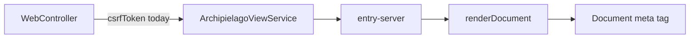

# Decouple dogfood CSRF from Archipielago packages

## Audit

Packages do not import `examples/*`. That [ADR-0032](../../docs/adr/0032-archipielago-pnpm-monorepo.md) invariant holds: no Prisma, sessions, passwords, page names, or protocol types in production engine code. `package.json` deps are only workspace engines plus peers (`react`, `vite`, Nest).

The publish-shaped leak is the named `csrfToken` argument on the SSR seam. Cookie sessions and the `<meta name="csrf-token">` tag are the Nest example’s behavior ([ADR-0006](../../docs/adr/0006-cookie-sessions-csrf.md)). Engines should not know that name.



Call chain today:

- [packages/core/src/server-entry.ts](../../packages/core/src/server-entry.ts) — `ServerEntry.render(..., csrfToken?: string)`
- [packages/react/src/runtime/ssr/render-document.tsx](../../packages/react/src/runtime/ssr/render-document.tsx) — `DocumentShellProps.csrfToken` and `RenderDocumentOptions.csrfToken`, passed into `<Document>`
- [packages/nestjs/src/archipielago-view.service.ts](../../packages/nestjs/src/archipielago-view.service.ts) — `render` options include `csrfToken` and JSDoc says it is embedded as a meta tag
- Example only: [examples/nestjs/src/web/web.controller.ts](../../examples/nestjs/src/web/web.controller.ts) reads `req.session?.csrfToken`; [examples/nestjs/src/web/ui/runtime/ssr/entry-server.tsx](../../examples/nestjs/src/web/ui/runtime/ssr/entry-server.tsx) forwards it; [examples/nestjs/src/web/ui/server-components/document/document.tsx](../../examples/nestjs/src/web/ui/server-components/document/document.tsx) emits the meta tag

Docs that freeze the leak: [docs/archipielago/guide/concepts.md](../../docs/archipielago/guide/concepts.md) (`render(..., csrfToken?)`) and [docs/archipielago/guide/nestjs.md](../../docs/archipielago/guide/nestjs.md).

**Left in place on purpose** (not this change):

- `defaultArchipielagoPaths` in [packages/core/src/paths.ts](../../packages/core/src/paths.ts) and cwd-based Vite discovery in [packages/vite/src/asset-pipeline.ts](../../packages/vite/src/asset-pipeline.ts). These are overridable Nest-sample defaults ([ADR-0030](../../docs/adr/0030-archipielago-host-config.md), TD-031). Phase 3 is where a second host forces `paths` onto host config. Changing them now would make the next phase a redesign, which is what we are trying to avoid.
- Test fixtures named `login-form`, `home`, `forms.scss`. They exercise the default layout; they are not a public API.
- Auth, `CsrfGuard`, and session types stay under `examples/nestjs/src/api/auth/`.

## End state

Replace the CSRF-specific argument with an opaque bag the host Document already owns. Engines forward it; they do not interpret it.

- `ServerEntry.render(page, props, createAssets, documentProps?: object)`
- `renderDocument` drops `csrfToken` from `DocumentShellProps` and `RenderDocumentOptions`. Add a generic extra:

```ts
renderDocument<TExtra extends object = Record<string, never>>(options: {
  renderPage: () => ReactElement;
  Document: ComponentType<DocumentShellProps & TExtra>;
  createAssets: (islandNames: string[]) => PageAssets | Promise<PageAssets>;
  documentProps?: TExtra;
}): Promise<RenderResult>
```

Spread `documentProps` onto `<Document>` (`{...(documentProps ?? {})}`). `DocumentShellProps` stays `{ children, assets }` only.

- `ArchipielagoViewService.render` options become `{ pageStylesheets?, documentProps?: object }`. JSDoc describes forwarding to the host entry, with no CSRF or meta-tag wording. The fourth `entry.render` argument is `options.documentProps`.

Example wiring (CSRF stays product-owned):

- `WebController` passes `{ documentProps: { csrfToken: req.session?.csrfToken } }` for home, login, and register.
- `entry-server.render` takes `documentProps?: { csrfToken?: string }` and passes it to `renderDocument`. `Document` is unchanged and still renders the meta tag.
- [packages/nestjs/src/archipielago-view.service.spec.ts](../../packages/nestjs/src/archipielago-view.service.spec.ts) forwards a neutral bag (for example `{ marker: 'host' }`) and does not mention CSRF.
- [examples/nestjs/src/web/web.controller.spec.ts](../../examples/nestjs/src/web/web.controller.spec.ts) expects `{ documentProps: { csrfToken } }`.

## Commits

Three implementation commits, then checks, then delete this file. Do not keep `csrfToken` on the package API for a commit just so the example still compiles. After the package commit the example is expected to fail typecheck until the example commit. Do not run lint, build, or tests as a gate between those commits. Do not publish packages or bump `private` / `0.0.0`.

1. **`refactor(archipielago): drop csrfToken from the render contract`** — Packages only. Replace `csrfToken` with `documentProps` on `ServerEntry`, `renderDocument`, and `ArchipielagoViewService`, including JSDoc and the view-service spec. The spec forwards a neutral bag and does not mention CSRF. Leave the example on the old call shape.
2. **`refactor(example): pass the CSRF token as document props`** — Example only. `WebController` passes `{ documentProps: { csrfToken: req.session?.csrfToken } }`. `entry-server.render` takes `documentProps?: { csrfToken?: string }` as its fourth argument and passes it to `renderDocument`. Update controller specs. `Document` still emits the meta tag.
3. **`docs(archipielago): record host document props on the SSR entry`** — Add [docs/adr/0034-host-document-props.md](../../docs/adr/0034-host-document-props.md) and an index row in [docs/adr/README.md](../../docs/adr/README.md). Decision: extra data for the product document shell travels as opaque `documentProps`; Archipielago packages do not name product session or CSRF fields. [ADR-0006](../../docs/adr/0006-cookie-sessions-csrf.md) stays Accepted. One thin cross-link from ADR-0006 to ADR-0034; do not rewrite that body. Update the guide and the Nest architecture SSR notes.

After those three commits, run `pnpm lint`, `pnpm build`, and the view-service and web-controller unit tests. If something fails, fix it in a follow-up commit. Do not rewrite the earlier commits to hide the intermediate break.

Delete this plan in a later commit before merge so the `plan-files` CI job passes ([ADR-0031](../../docs/adr/0031-project-plan-files.md)).

## Todos

- [ ] `contract` — Replace csrfToken with opaque documentProps on the package render contract (pending)
- [ ] `example` — Pass session CSRF through documentProps from the Nest example (pending)
- [ ] `docs-adr` — Add ADR-0034 and update the living SSR docs (pending)
- [ ] `checks` — Run lint, build, and the affected unit tests after the implementation commits (pending)
- [ ] `delete-plan` — Delete this plan file in a later commit (pending)
