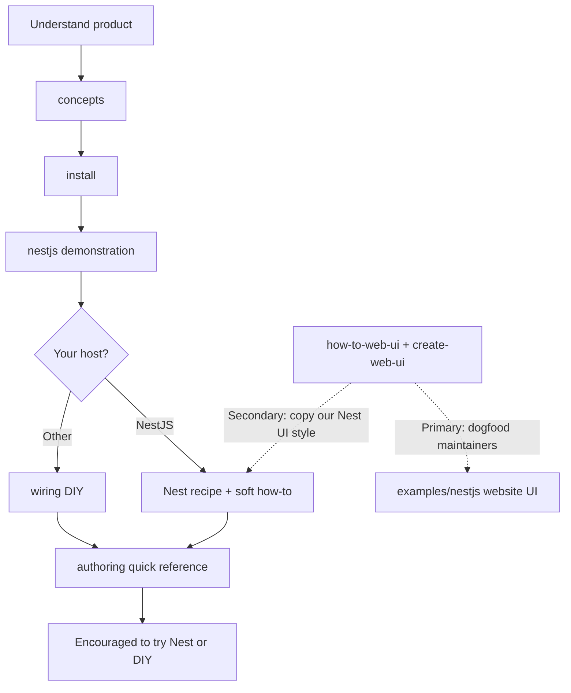

# Docs: consumer journey vs dogfood maintainer path

## Context

First plan ([`.cursor/plans/2026-11-01-archipielago-product-repo-framing.md`](.cursor/plans/2026-11-01-archipielago-product-repo-framing.md)) established product identity and a linear guide order. This **second plan on the same PR/branch** (`docs/archipielago-product-repo-framing`) finishes the DX story: a convincing walkthrough from finding Archipielago through trying Nest or DIY, with concerns separated so agents stop treating the dogfood cookbook as the consumer path.

Commit this plan under [`.cursor/plans/`](.cursor/plans/) ([ADR-0031](docs/adr/0031-project-plan-files.md)). Delete **both** framing plan files before merge. Docs + AGENTS/skill pointer edits only. Out of scope: plan-lifecycle polish, TD-034/035/036 implementation, scaffolder extraction, mass ADR-citation rewrite outside files this pass touches.

If clarifying questions are needed mid-implementation and AskQuestion is unavailable, ask in normal chat and wait.

## Audience model

| Audience                                 | Journey                                                                                                  | Docs                                                                                                                             |
| ---------------------------------------- | -------------------------------------------------------------------------------------------------------- | -------------------------------------------------------------------------------------------------------------------------------- |
| **Package consumer**                     | concepts → install → **see Nest working** → stay on Nest **or** DIY `wiring` → **authoring** cheat sheet | `docs/archipielago/guide/**`                                                                                                     |
| **Dogfood / Nest-example UI maintainer** | Day-to-day pages/islands/scaffold for `examples/nestjs`                                                  | [`how-to-web-ui.md`](docs/how-to-web-ui.md), [`create-web-ui`](.agents/skills/create-web-ui/SKILL.md), [AGENTS.md](AGENTS.md) §8 |

**Dual role of `examples/nestjs`:** (1) documented Nest host demonstration/recipe for consumers; (2) future dogfood website host. Shared tree; **separate doc lanes**. Consumer Nest path = [`guide/nestjs.md`](docs/archipielago/guide/nestjs.md) + [`examples/nestjs/README.md`](examples/nestjs/README.md) + [`guide/authoring.md`](docs/archipielago/guide/authoring.md). Cookbook/scaffold is the maintainer workflow that _proves_ dogfooding—not “step N of install the package.”

## Journey order (replace linear wiring→authoring→nestjs)

Update [`docs/archipielago/README.md`](docs/archipielago/README.md) and [`docs/archipielago/guide/README.md`](docs/archipielago/guide/README.md):

1. **concepts** — primitives / ownership
2. **install** — packages (keep before Nest so “run the example” is actionable)
3. **nestjs** — **demonstration + documented host recipe** (how concepts look when connected in this repo / site)
4. **Divergence:** NestJS host → continue with Nest adapter + authoring; other host → **wiring** then authoring
5. **authoring** — post-connect **quick reference** (SSR vs island, canonical island shape, props, CSS lanes)

Separate callout (not numbered consumer spine): **In this monorepo / dogfood website UI** → how-to-web-ui (soft fence; see below).

Fix Next-steps / intros so arrows match (today authoring points _back_ to wiring).

### Per-page handoffs

- [`nestjs.md`](docs/archipielago/guide/nestjs.md): lead = demonstration/recipe after install; mapping table stays. Point to example runbook. After Nest: authoring for ongoing UI rules; soft link to how-to for copying this example’s UI style / in-repo site work. DIY readers: continue to wiring.
- [`wiring.md`](docs/archipielago/guide/wiring.md): DIY path after seeing Nest (or instead of Nest as host). Host-agnostic; no Nest-only steps. End → authoring.
- [`concepts.md`](docs/archipielago/guide/concepts.md) / [`install.md`](docs/archipielago/guide/install.md): light forward links to match new order only.

## Soft-fence how-to / create-web-ui

Primary audience: maintainers of the Nest-example / dogfood **website** UI. Secondary: Nest hosts who choose to follow this example’s conventions (not forced beyond framework requirements).

Tone: this is the real maintainer workflow—feel free to use it if you follow our style; it dogfoods Archipielago at developer level. Not a hard “consumers keep out.”

Touch:

- [`docs/how-to-web-ui.md`](docs/how-to-web-ui.md) lead
- [`.agents/skills/create-web-ui/SKILL.md`](.agents/skills/create-web-ui/SKILL.md) audience line
- [`AGENTS.md`](AGENTS.md) §8 — dogfood/`examples/nestjs` first; consumer path = guide
- Consumer landings that still peer how-to with authoring: root [`README.md`](README.md) Documentation, [`docs/architecture.md`](docs/architecture.md) how-to / See also, [`examples/nestjs/README.md`](examples/nestjs/README.md) — label soft fence; keep runbook useful

## Thin [`authoring.md`](docs/archipielago/guide/authoring.md)

Role: **final DIY / long-term reminder** after the host is connected—not islands-architecture essay, not a Nest cookbook.

Keep / sharpen:

- Prereq one-liner: wiring or Nest recipe done
- Interactivity boundary table + CSS-as-island anti-pattern
- What **must** be canonical (island folder/registration/serializable props) vs host-owned freer SSR trees—one short sentence on _why_ islands need shape, not a standalone section
- Page embed props outside UI modules
- CSS lanes at product-policy level
- Next: DIY/Nest cross-links; soft how-to for Nest-style UI / dogfood maintainers

Do **not** dump `examples/nestjs/...` step lists into authoring. Do **not** mention Nest except in Next-steps pointers.

## ADR link convention (touched guide prose only)

In consumer guide pages this pass edits: state the rule in plain language; optional depth as **[Learn why](…adr…)** or **[See more](…)**—do **not** lead with `(ADR-00xx)` in body text. Numbers stay in ADR index, ADR bodies, architecture decision indexes, AGENTS/process. One why-link per rule max. No repo-wide citation sweep.

## Framing rules for this pass

- Consumer spine never _requires_ how-to-web-ui or `pnpm scaffold:web-ui`.
- Nest documented host = demonstration + `guide/nestjs` + example runbook + authoring—not “read the dogfood cookbook first.”
- DIY = wiring + authoring after (or instead of) choosing Nest as host.
- Separate concerns: no Nest in host-agnostic rule bodies.
- Encourage trying Nest replication **or** DIY by the end of the guide landings.

## Delivery

1. Save/commit this plan on the framing branch (workspace `.cursor/plans/`).
2. Apply journey landings → nestjs/wiring handoffs → authoring thin rewrite → soft-fence how-to/skill/AGENTS/inbound pointers; `pnpm format` if Prettier touches markdown.
3. Conventional `docs:` commits per slice.
4. Delete both framing plan files before merge (`plan-files` CI).
