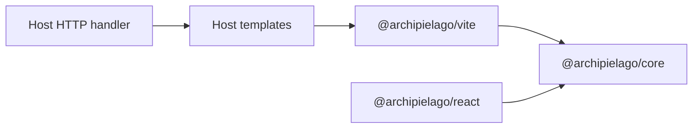

# Concepts

Host-agnostic mental model for Archipielago—what the host owns vs what the
packages own, and the primitives they share.

Reading order from here:

- Next: [install.md](./install.md)
- Then see the concepts live: [nestjs.md](./nestjs.md)
- Wiring a non-Nest host yourself: [wiring.md](./wiring.md)
- After you are connected: [authoring.md](./authoring.md) (UI cheat sheet)

## Ownership split

| Owner                                          | Owns                                                                                                                    | Does not own                             |
| ---------------------------------------------- | ----------------------------------------------------------------------------------------------------------------------- | ---------------------------------------- |
| **Host app**                                   | HTTP framework, routing, auth, data, document templates, page-prop types, stylesheet opt-in maps, Vite app entry config | Core asset-tag assembly, hydrate runtime |
| **`@archipielago/core`**                       | `PageAssets`, path roots, host config load/apply, shell CSS budget                                                      | Nest/Express types, product page names   |
| **`@archipielago/react`**                      | Browser hydrate, props codec                                                                                            | Host HTTP, product globs, the document   |
| **`@archipielago/vite`**                       | Dev asset pipeline, page loader, manifest → tags, Vite plugins (including island CSS sidecar)                           | Framework DI modules                     |
| **Host adapter** (e.g. `@archipielago/nestjs`) | `mountArchipielagoAssets` (static client or Vite middleware)                                                            | Product HTML, Nest DI renderer           |

The Nest example’s document is Handlebars. Islands are prebuilt HTML that the
template includes. React hydrates only those wrappers
([ADR-0035](../../adr/0035-handlebars-drih-islands.md)).

## Primitives

### `PageAssets`

Stylesheets, optional inlined shell CSS, and module scripts for one HTML
response. The host prints `tags` in the document. Island CSS is **not** in this
bag: the host prints `<style data-css-island>` from a prebuilt sidecar when it
includes a dehydrated island.

### Island module glob

Hosts call `setIslandModules(import.meta.glob(...))` from a Vite-owned file
under their product `ui/islands/` tree. Hydrate builds lazy loaders from that
map. Unknown `data-component-name` values are skipped.

### Path roots (`ArchipielagoPaths`)

Where islands, hydrate entry, client out, and shell CSS live. Defaults match a
conventional `src/web/…` host layout when the process cwd is the host package.
Override with `setArchipielagoPaths` when needed.

### Asset pipeline

`createDevAssetPipeline` / `clientAssetsRoot` create Vite middleware or the
production static root. The **host** mounts them on its HTTP server. Opt-in
page stylesheets are registered via `setPageStylesheetRegistry`; pages pass
sheet ids into `createPageAssets`.

### Product document

The host owns the HTML document (Handlebars in the Nest example; Blade in
Laravel). Archipielago does not render a React `Document` at request time.

### Template locals vs island props

| Channel      | Who reads it             | Typical data                          |
| ------------ | ------------------------ | ------------------------------------- |
| View locals  | The document / page view | Body content, CSRF, stylesheet opt-in |
| Island props | One dehydrated wrapper   | JSON props for that client root       |

CSRF is a template local on the same object as page fields. Packages do not
name `csrfToken`. The Nest recipe shows that object in [nestjs.md](./nestjs.md).
The example’s live field is the session CSRF token; see
[examples/nestjs/docs/architecture.md](../../../examples/nestjs/docs/architecture.md#csrf-and-other-template-locals).

## How pieces connect

1. Bootstrap: register page stylesheets; mount assets; dehydrate islands
   before start / build / e2e.
2. Request: host builds view locals → template engine renders the document.
3. Include: `{{{hydrate "name"}}}` prints sidecar CSS plus the Drih wrapper.
4. Assets: layout helpers call `createPageAssets` from the include set.
5. Browser: hydrate entry loads named islands only → `hydrateRoot` on each
   wrapper.
