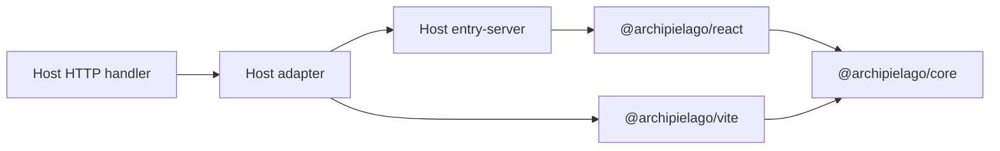

# Concepts

Host-agnostic mental model for Archipielago—what the host owns vs what the
packages own, and the primitives they share.

Reading order from here:

- Next: [install.md](./install.md)
- Then see the concepts live: [nestjs.md](./nestjs.md)
- Wiring a non-Nest host yourself: [wiring.md](./wiring.md)
- After you are connected: [authoring.md](./authoring.md) (UI cheat sheet)

## Ownership split

| Owner                                          | Owns                                                                                                                                                   | Does not own                                               |
| ---------------------------------------------- | ------------------------------------------------------------------------------------------------------------------------------------------------------ | ---------------------------------------------------------- |
| **Host app**                                   | HTTP framework, routing, auth, data, product pages/islands/`Document`, page-prop types, island manifest, stylesheet opt-in maps, Vite app entry config | Core render algorithm, hydrate runtime, asset-tag assembly |
| **`@archipielago/core`**                       | `RenderResult`, `PageAssets`, island table contracts, generic `ServerEntry`, path/config shapes                                                        | Nest/Express types, product page names                     |
| **`@archipielago/react`**                      | `<Island>`, two-pass `renderDocument`, browser hydrate, props codec                                                                                    | Host HTTP, product globs                                   |
| **`@archipielago/vite`**                       | Dev asset pipeline, page loader, manifest → tags, Vite plugins                                                                                         | Framework DI modules                                       |
| **Host adapter** (e.g. `@archipielago/nestjs`) | Thin bridge: injectable renderer, mount helpers                                                                                                        | Product UI                                                 |

## Primitives

### `RenderResult`

Full HTML document (`html`) plus an `assets` bag. The Nest adapter returns
`html` only; other hosts may assemble from `assets` later.

### `ServerEntry<TPages>`

SSR entry contract: `render(page, props, createAssets, documentProps?)`.
`TPages` is a **host-owned** map of page name → props. Core never imports app
page-prop modules. The fourth argument is [document props](#document-props).

### Islands table

`registerIslands(manifest)` injects the name → metadata map engines use.
Hosts maintain the manifest (`auto` sync or `manual`). Engines do not scan
the filesystem at request time.

### Island module glob

Hosts call `setIslandModules(import.meta.glob(...))` from a Vite-owned file
under their product `ui/islands/` tree. Hydrate builds lazy loaders from that
map + the registered names.

### Path roots (`ArchipielagoPaths`)

Where islands, hydrate entry, SSR entry, client out, and shell CSS live.
Defaults match a conventional `src/web/…` host layout when the process cwd is
the host package. Override with `setArchipielagoPaths` when needed.

### Asset pipeline

`createDevAssetPipeline` / `clientAssetsRoot` create Vite middleware or the
production static root. The **host** mounts them on its HTTP server. Opt-in
page stylesheets are registered via `setPageStylesheetRegistry`; pages pass
sheet ids into render.

### Product `Document` + page map

`entry-server` (host-owned) supplies the React page map and document shell,
then calls `renderDocument` from `@archipielago/react`.

### Document props

`documentProps` is the host-owned bag for the document shell: the `<html>`
wrapper around a page. Packages accept it on `ServerEntry.render`,
`renderDocument`, and (for Nest) `ArchipielagoViewService.render`, then spread
it onto the host `Document` together with `children` and `assets`. Engines do
not read the keys ([ADR-0034](../../adr/0034-host-document-props.md)).

Use it for data the shell needs on that request: a meta tag, a title, or
another head field. Keep it separate from page embed props and island props:

| Channel          | Who reads it        | Typical data                            |
| ---------------- | ------------------- | --------------------------------------- |
| Page embed props | The selected page   | Body content for that route             |
| `documentProps`  | The host `Document` | Shell / `<head>` fields for the request |
| Island props     | One `<Island>`      | JSON props for that client root         |

To forward a field:

1. Add it to your `Document` props, beside `children` and `assets`.
2. In `entry-server`, take `documentProps` as the fourth `render` argument and
   pass it through to `renderDocument`.
3. On each HTML request, build that object in the HTTP handler and pass it
   into `ServerEntry.render` (or the host adapter’s render options).

```ts
export async function render(page, pageProps, createAssets, documentProps) {
  return renderDocument({
    renderPage: () => <Page {...pageProps} />,
    Document,
    createAssets,
    documentProps,
  });
}
```

```tsx
function Document({ children, assets, csrfToken }) {
  return (
    <html lang="en">
      <head>
        {csrfToken !== undefined ? (
          <meta name="csrf-token" content={csrfToken} />
        ) : null}
      </head>
      <body>{children}</body>
    </html>
  );
}
```

Omit `documentProps` when the shell only needs `children` and `assets`. The
Nest recipe shows the adapter options object in [nestjs.md](./nestjs.md). The
example’s live field is the session CSRF token; see
[examples/nestjs/docs/architecture.md](../../../examples/nestjs/docs/architecture.md#document-props-in-this-example).

## How pieces connect



1. Bootstrap: register islands (+ modules + page stylesheets); mount assets.
2. Request: host builds page props and, when the shell needs them,
   `documentProps` → adapter/`ServerEntry.render`.
3. Render: React SSR + asset tags → full document string.
4. Browser: hydrate entry registers islands/modules → selective hydrate.
