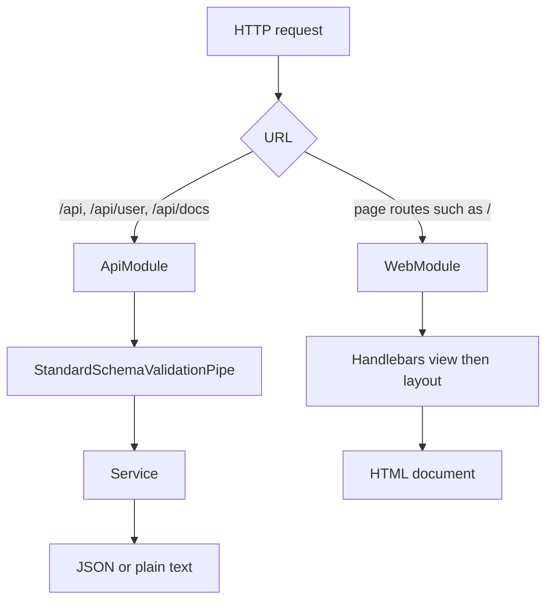
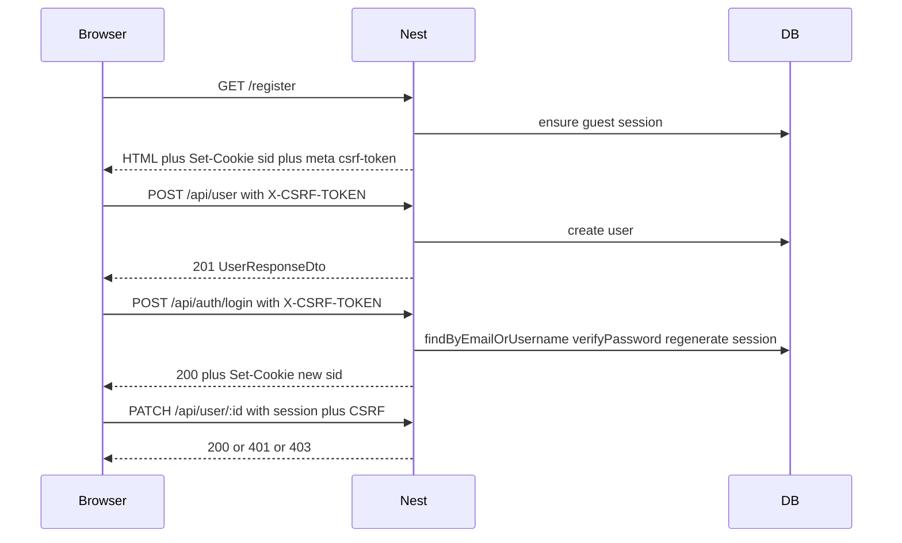
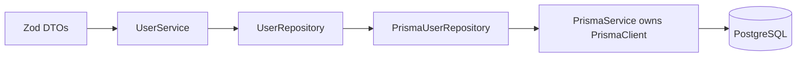
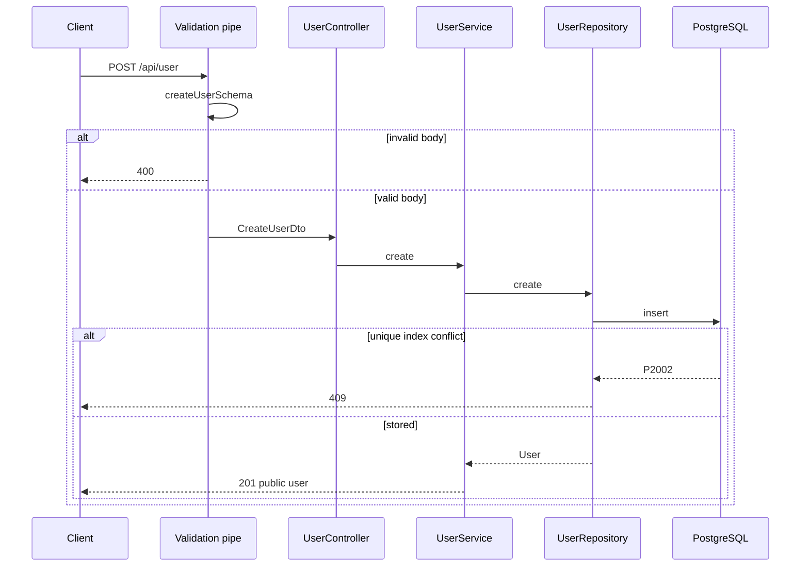
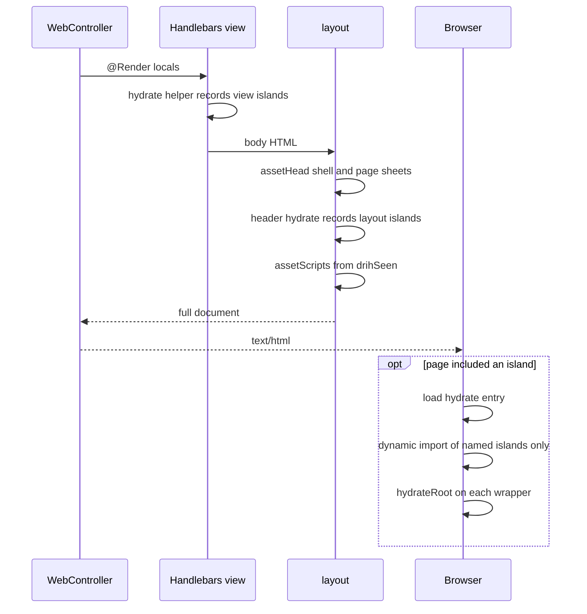
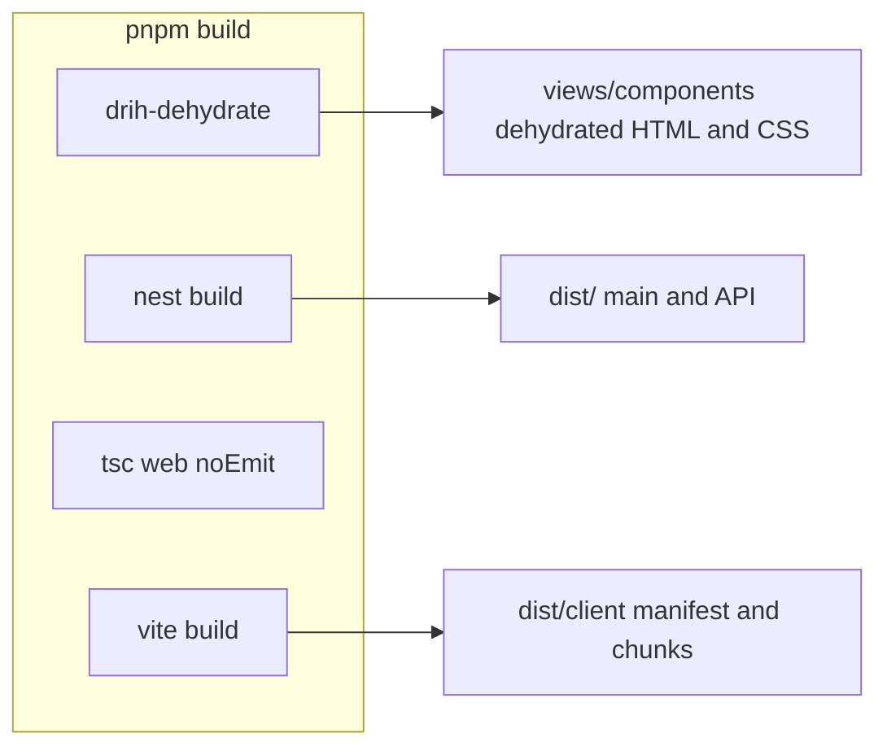

# Architecture

Current-state map of this **NestJS host example** / dogfood website
(`examples/nestjs`) and how it consumes `@archipielago/*`. For maintainers of
this example and anyone copying its style.

Host-agnostic product guide: [docs/archipielago/guide/](../../../docs/archipielago/guide/README.md).
Monorepo process (including agent plans): [workflow.md](../../../docs/archipielago/workflow.md).

In the Nest example, one Nest process serves two surfaces. The JSON API lives under `/api`. HTML pages live at the root. Nest owns routes and data. Handlebars owns the document. React hydrates only the islands a page actually included.

A controller uses `@Render` and returns a typed locals object. It does not import `.tsx`. See [ADR-0001](../../../docs/adr/0001-one-nest-process.md), [ADR-0002](../../../docs/adr/0002-islands-ssr-ui.md), and [ADR-0035](../../../docs/adr/0035-handlebars-drih-islands.md). Decision index: [docs/adr/](../../../docs/adr/README.md).

## Request split



| Surface     | Owner                     | Examples                                                        | Response                                               |
| ----------- | ------------------------- | --------------------------------------------------------------- | ------------------------------------------------------ |
| JSON API    | `examples/nestjs/src/api` | `GET /api`, `POST /api/user`, `GET /api/docs`                   | JSON, or the hello string                              |
| HTML pages  | `examples/nestjs/src/web` | `GET /`                                                         | `text/html`                                            |
| Dev assets  | Vite middleware           | `/@vite/client`, `/src/web/ui/runtime/island/hydrate-entry.tsx` | Modules, only when `NODE_ENV` is not `production`      |
| Prod assets | `dist/client`             | `/assets/...`                                                   | Built client files, `index: false` so `/` stays a page |

`GET /user` and `GET /docs` are not aliases. They 404. Swagger UI is `/api/docs`. The raw spec is `/api/docs-json`.

Page controllers must not claim `/api`, `/assets`, `/src`, or `/@vite`. Those prefixes belong to the API, the production client build, or the Vite dev server.

`LoggerMiddleware` runs on every route and then calls through.

## Source layout

Folder names do not create URL prefixes. `RouterModule` does ([ADR-0003](../../../docs/adr/0003-router-module-prefixes.md)).

```text
packages/
  core/                   PageAssets, paths, config, island helpers
  react/                  lazy island hydrate + props codec
  vite/                   page loader, asset delivery, pipeline, and Vite plugins
  nestjs/                 asset mount helper
examples/nestjs/
  src/
    main.ts               bootstrap (Handlebars + Drih + assets)
    app.module.ts         wires API, web, and the /api prefix
    api/                  JSON feature code
    persistence/          PrismaModule / PrismaService / PrismaPg helper
    generated/prisma/     Prisma Client output (`prisma generate`; gitignored)
    web/                  Nest controller and product-owned page policy
      protocol/           App-owned view locals
      ui/                 Product Vite/React islands
  views/                  Handlebars layouts, partials, and pages
    components/           gitignored dehydrated HTML and island CSS sidecars
  prisma/                 schema, migrations, and seed
  test/                   HTTP and browser e2e support
```

The root package owns orchestration and shared tooling. `pnpm build` compiles
core, Vite, and Nest adapters before filtering into the Nest example. Inside
the example, `tsconfig.build.json` excludes `src/web/ui/**`, while
`tsconfig.web.json` typechecks product UI, `packages/react`, and protocol.
Vite emits the browser hydrate bundle that actually runs. See
[ADR-0017](../../../docs/adr/0017-dual-typescript-build.md) and
[ADR-0032](../../../docs/adr/0032-archipielago-pnpm-monorepo.md).
`src/web/ui` is Vite-owned, not Nest emit; leaving it under `src/` next to the
Nest HTML host is [TD-040](../../../docs/known-tech-debt.md).

**Import specifiers:** Nest-emitted graphs (`examples/nestjs/src/api/`, Nest web root, `web/protocol`) and Node packages (`packages/core`, `packages/vite`, `packages/nestjs`) use **`.js`** emit names under `"type": "module"` + `nodenext`. Vite-owned `examples/nestjs/src/web/ui/**` and `packages/react/**` use **extensionless** relatives (`bundler` resolution). Consumers import engines through real `@archipielago/core`, `@archipielago/react`, `@archipielago/vite`, and `@archipielago/nestjs` package exports; product aliases remain `@ui` / `@protocol` / `@api` ([ADR-0027](../../../docs/adr/0027-ui-path-aliases.md)). See [ADR-0024](../../../docs/adr/0024-dual-import-resolution.md). Product UI components use **one folder per component** with a thin `index.ts` barrel; island hydrate loaders import the concrete implementation file ([ADR-0025](../../../docs/adr/0025-per-component-folders.md)). Colocated Storybook stories (`pnpm storybook`) are a local workshop, not QA ([ADR-0026](../../../docs/adr/0026-storybook-ui-workshop.md)).

Prefer `.tsx` where the file is mostly a React tree (islands, hydrate entry, shared components). Prefer plain `.ts` for Nest controllers, protocol locals, registries, and tests. Specs stay `.ts` and use `createElement` when they need elements.

## JSON API

### Routing

`AppModule` registers the prefix on the module that owns the controllers ([ADR-0003](../../../docs/adr/0003-router-module-prefixes.md)):

```ts
RouterModule.register([
  {
    path: 'api',
    module: ApiModule,
    children: [{ path: '/', module: UserModule }],
  },
]);
```

`RouterModule` sets the path on that module, not on modules it merely imports. `UserModule` is listed as a child so `@Controller('user')` becomes `/api/user`. `AppController` sits on `ApiModule`, so its `@Controller()` route is `GET /api`.

E2E boots `AppModule` and never runs `src/main.ts`. The prefix lives in the module graph. A test that imports `UserModule` alone will not see `/api`.

`WebModule` is imported with no path, so page routes stay at the root.

### Zod and the validation pipe

`main.ts` installs `StandardSchemaValidationPipe` globally ([ADR-0004](../../../docs/adr/0004-zod-standard-schema-http.md)). Controllers pass the Zod schema on the parameter decorator. The pipe validates and transforms the value before the handler runs. A failure is HTTP 400.

```ts
@Body({ schema: createUserSchema }) createUserDto: CreateUserDto
@Param('id', { schema: userIdSchema }) id: string
```

Schemas are the source of the TypeScript types (`z.infer`). Current contracts:

| Schema               | Rules                                                                                                                                                                                                                                                         |
| -------------------- | ------------------------------------------------------------------------------------------------------------------------------------------------------------------------------------------------------------------------------------------------------------- |
| `createUserSchema`   | Strict object: email, username, display name, password via shared `passwordSchema` (min 12 / max 128, NIST-oriented; no composition rules). Unknown keys are rejected. Usernames are trimmed, a leading `@` is stripped, then checked for length and pattern. |
| `updateUserSchema`   | Create schema without email and username, every remaining field optional, still strict, and at least one of `displayName` or `password` is required.                                                                                                          |
| `userIdSchema`       | UUID path parameter.                                                                                                                                                                                                                                          |
| `userResponseSchema` | Public user: `id`, `email`, `username`, `displayName`, `verified`. No password.                                                                                                                                                                               |

### Users, passwords, and responses

`UserService` builds domain `User` values (UUID, Argon2id hash, field-by-field from the DTO) and persists them through a **repository port** (`USER_REPOSITORY` / `UserRepository`). The Prisma adapter (`PrismaUserRepository`) is the only place that imports the generated Prisma Client. Controllers and the service never depend on Prisma types. Feature mapping lives in `user.mapper.ts`: persistence row → domain (`toDomainUser`) and domain → public DTO (`toUserResponseDto`). See [ADR-0005](../../../docs/adr/0005-persistence-postgres-prisma.md), [ADR-0008](../../../docs/adr/0008-argon2id-passwords.md), and [ADR-0009](../../../docs/adr/0009-allowlisted-responses-delete-204.md).

Email and username uniqueness is enforced by Postgres expression unique indexes on `LOWER(email)` and `LOWER(username)` (see `prisma/migrations`). Unique violations surface as Prisma `P2002` and become HTTP 409 in the adapter.

`hashPassword` uses Argon2id. Cost parameters are constants in `src/api/common/password.ts` (see [TD-005](../../../docs/known-tech-debt.md)). The Prisma seed imports the same helper so hashing does not drift.

`toUserResponseDto` returns an allowlisted object. There is no response interceptor that filters bodies at the edge yet (see [TD-007](../../../docs/known-tech-debt.md)).

Delete returns 204 whether or not the id existed.

`POST /api/user` is guest signup (CSRF + rate limit). `PATCH`/`DELETE` require an authenticated session and ownership of `:id` ([ADR-0007](../../../docs/adr/0007-user-mutation-authz.md)). The public list endpoint was removed.

### Sessions and CSRF

Browser mutations use cookie sessions plus a CSRF token ([ADR-0006](../../../docs/adr/0006-cookie-sessions-csrf.md)):

- **Session middleware** loads or creates a guest session from the HttpOnly `sid` cookie and attaches it to the request for HTML pages and `/api` (Vite/static asset paths are skipped).
- **CsrfGuard** (global) requires header `X-CSRF-TOKEN` to match the session token on mutating `/api` methods (`POST` / `PATCH` / `DELETE` / `PUT`). Safe methods and non-API routes pass through.
- The Handlebars layout prints `<meta name="csrf-token" content="…">` when `csrfToken` is set. The session token reaches that tag as a [template local](#csrf-and-other-template-locals). There is **no** JSON CSRF mint endpoint; e2e obtains the token by loading `/register` or `/login` (same as the browser).
- Login regenerates the session id and attaches `userId` (see AuthModule). Session rows live in Postgres (`sessions`).



### Frontend contract (islands → API)

Login/register islands submit via `useApiMutation` (react-hook-form + Zod on the forms). Keep client and server aligned:

1. Read `<meta name="csrf-token">` via `getCsrfToken` / `getCsrfTokenHeader` under `src/web/ui/api-fetch/`.
2. Call `/api/...` with native `fetch`, spreading `apiRequestDefaults` (`credentials: 'same-origin'`, JSON content type) and `...getCsrfTokenHeader()`.
3. Reuse shared Zod pieces from `src/shared/schemas/` (e.g. `passwordSchema`, `emailSchema`) and compose with API DTOs (`createUserSchema`, `loginSchema`) for RHF resolvers — do not re-state field rules in the island.
4. Map HTTP outcomes to UI: client Zod / **400** field errors, **409** uniqueness on register, **401** generic login failure (“Invalid credentials”), **403** missing/invalid CSRF, **429** throttle. Form-level API errors use plain colored text (`.form-api-error`), not Bootstrap alerts.
5. Register succeeds with **201** then navigates to `/login` (no auto-login). Login succeeds with **200** then navigates to `/`. Logout is best-effort (always navigate to `/login` after the attempt).
6. Nav auth chrome is template-driven from `req.session.userId` (`isAuthenticated` local). Desktop logout is an island; the closed mobile-nav tree is the button. `/login` and `/register` redirect authenticated users to `/`.

UI unit tests run in Vitest browser mode; auth journeys use Playwright against Nest ([ADR-0021](../../../docs/adr/0021-vitest-browser-ui-testing.md)). HTTP e2e remains the API contract gate. Local browser installs target Playwright’s durable default cache via `env -u PLAYWRIGHT_BROWSERS_PATH` on Unix/WSL ([ADR-0022](../../../docs/adr/0022-unix-wsl-playwright-browser-cache.md); [TD-027](../../../docs/known-tech-debt.md)).

### Persistence

PostgreSQL is the system of record. Prisma 7 owns the database schema and CLI; the app talks through `@prisma/adapter-pg`. Zod owns HTTP contracts. Domain `User` is the port type. `PrismaService` composes `PrismaClient`. See [ADR-0005](../../../docs/adr/0005-persistence-postgres-prisma.md). Global Prisma module init always `$connect`s for the process lifetime (see [TD-012](../../../docs/known-tech-debt.md)).

`prisma generate` writes the Prisma Client to `src/generated/prisma` (gitignored). SQL history lives in `prisma/migrations/` and is applied with `prisma migrate deploy`.



| Concern         | How                                                                                                                                                   |
| --------------- | ----------------------------------------------------------------------------------------------------------------------------------------------------- |
| Local manual DB | Docker Compose (`docker-compose.yml`) + GNU Make (`make db-up`, `make db-migrate`, `make db-seed`)                                                    |
| App connection  | `DATABASE_URL` in `.env` / `prisma.config.ts` (see `.env.example`); required for migrate/seed/runtime, not for generate alone                         |
| Nest wiring     | Global `PrismaModule` / `PrismaService` (composes `PrismaClient` + PrismaPg); `UserModule` factory-binds the repository adapter                       |
| E2E database    | Testcontainers Postgres (not Compose); migrate deploy once per run; truncate between tests ([ADR-0010](../../../docs/adr/0010-e2e-testcontainers.md)) |
| Client codegen  | `prisma generate` → `src/generated/prisma` on `postinstall` and at the start of `pnpm build` (works without a live DB / `.env`)                       |

### OpenAPI

`setupOpenApi` runs after the global pipe so the documented routes match runtime validation ([ADR-0004](../../../docs/adr/0004-zod-standard-schema-http.md)). `SwaggerModule.setup('api/docs', ...)` serves the UI. Nest exposes the raw document at `/api/docs-json`. The document is built on first request.

Response schemas are generated from Zod, using the output shape:

```ts
z.toJSONSchema(schema, { target: 'openapi-3.0', io: 'output' });
```

Controllers attach those objects with `@ApiOkResponse`, `@ApiCreatedResponse`, and the error decorators. `WebController` is marked `@ApiExcludeController()`, so HTML routes stay out of the spec.

Swagger is served in every environment today while the app is local-only (see [TD-006](../../../docs/known-tech-debt.md)).



## Web pages

Product home (vision and milestones): [docs/archipielago/](../../../docs/archipielago/).

### Roles

| Piece                                     | Responsibility                                                                 |
| ----------------------------------------- | ------------------------------------------------------------------------------ |
| `WebController`                           | `@Render` plus typed locals (`WebViewLocals`). Guest-only redirects stay here. |
| Handlebars layout `views/layouts/app.hbs` | Document shell, CSRF meta, asset helpers, header/footer partials.              |
| `{{{hydrate "name"}}}`                    | Drih include: sidecar `<style>` plus wrapper div.                              |
| Page view `views/*.hbs`                   | Page body. May include islands.                                                |
| `@archipielago/react` `hydrateIslands`    | Browser entry. Hydrates Drih wrappers and nothing else.                        |

View locals live in `protocol/page-props/*-page.locals.ts` (`*PageLocals`) plus `csrfToken` and `pageStylesheets` on `WebViewLocals`. The controller imports those types, not React ([ADR-0029](../../../docs/adr/0029-archipielago-in-repo-isolation.md); [ADR-0035](../../../docs/adr/0035-handlebars-drih-islands.md)).

### CSRF and other template locals

`csrfToken` is a Handlebars local on the same object as page fields. The layout prints `<meta name="csrf-token">` when it is set. Packages do not name that field. TD-037 and TD-038 are closed.

### Request render

Drih writes island HTML before the request. Nest renders the view, then the layout ([ADR-0035](../../../docs/adr/0035-handlebars-drih-islands.md)).



`createPageAssets([])` returns the shared stylesheet and no hydrate script. `{{{assetHead}}}` always uses that bag. `{{{assetScripts}}}` reads `drihSeen` after the layout header, so home navigation islands still load the hydrate entry. A page with no islands at all does not download it.

### Islands

An island is a client component with its own React root. The template includes it with `{{{hydrate "name"}}}`. See [ADR-0012](../../../docs/adr/0012-island-boundaries.md) and [ADR-0035](../../../docs/adr/0035-handlebars-drih-islands.md).

The wrapper is:

```html
<style data-css-island="mobile-navigation">
  /* hashed module rules, first include only */
</style>
<div data-component-name="mobile-navigation" data-component-props="{...}">
  <!-- dehydrated HTML -->
</div>
```

`data-component-props` is JSON (Handlebars may hex-escape quotes). The decoder rejects arrays, null, and non-objects. Props must be JSON-serializable plain objects.

`hydrateRoot` is called on the wrapper element. React hydrates the component as that element's children. The wrapper div is the container, not part of the component tree.

Islands do not share React context or state after hydration (see [TD-008](../../../docs/known-tech-debt.md)).

### Lazy chunks

The app hydrate entry (`ui/runtime/island/hydrate-entry.tsx`) calls Archipielago `hydrateIslands`. Loaders come from a filtered `import.meta.glob` of `ui/islands/*/*.tsx` (dirname===basename only). The DOM is the allowlist; unknown names are skipped.

Vite emits a separate chunk per dynamic `import()`. `assetTagsFromManifest` emits the hydrate entry and its static `imports`; it does not walk `dynamicImports`. Vite may still inject runtime `modulepreload` when a dynamic `import()` runs ([ADR-0012](../../../docs/adr/0012-island-boundaries.md); revisit with [TD-010](../../../docs/known-tech-debt.md)).

Product islands live under `examples/nestjs/src/web/ui/islands/`; loaders registry, props codec, and hydrate live under
`packages/react/src/runtime/island/` ([ADR-0018](../../../docs/adr/0018-island-runtime-folder.md);
[TD-019](../../../docs/known-tech-debt.md) closed). The Nest consumer is a workspace package
under `examples/nestjs`; page names and stylesheet policy remain example-owned
([ADR-0032](../../../docs/adr/0032-archipielago-pnpm-monorepo.md)).

### Styles

Portable rules: [archipielago/guide/authoring.md](../../../docs/archipielago/guide/authoring.md). Nest-example / dogfood website cookbook: [how-to-web-ui.md](../../../docs/how-to-web-ui.md). Decisions: [ADR-0013](../../../docs/adr/0013-css-three-lanes.md), [ADR-0014](../../../docs/adr/0014-forms-sibling-stylesheet.md), [ADR-0015](../../../docs/adr/0015-island-css-sibling-style.md).

CSS ships in **three lanes**:

| Lane                   | When                                             | Role                                                                       |
| ---------------------- | ------------------------------------------------ | -------------------------------------------------------------------------- |
| **Shell**              | Every HTML page                                  | Shared layout/content language                                             |
| **Page sibling sheet** | Only pages that opt in (`pageStylesheetsByPage`) | Shared Bootstrap component CSS that must not tax every page (today: forms) |
| **Island module**      | Only when that island is rendered                | Small non-Bootstrap interaction decoration; tokens-only Sass API           |

**Shell** (`src/web/ui/styles/shell.scss`): handpicked Bootstrap Option B — config (including the utilities Sass map), `root`, `reboot`, `type`, `images`, `containers`, and `grid`, plus handpicked `_buttons.scss`. No Bootstrap forms in the shell. Own Vite client input. Compilation: Sass → PostCSS (media-query sort + doiuse warn) → Lightning CSS minify at **Baseline Widely Available**. Build **reports** raw + gzip vs `SHELL_CSS_BUDGET_BYTES` (default 50 KiB). **Production** inlines the shell as `<style data-css="shell">` when **raw** size ≤ that budget; otherwise keeps a `<link>`. **Development** always `<link href="/src/web/ui/styles/shell.scss">` plus `/@vite/client` for HMR. Fixture tests cover both shell modes.

**Forms sibling:** [`examples/nestjs/src/web/ui/styles/forms.scss`](../src/web/ui/styles/forms.scss) (Vite input `forms`). Pages list `'forms'` in the example-owned [`pageStylesheetsByPage`](../src/web/page-stylesheets.ts), which the controller puts on view locals. Selective Bootstrap partials: `forms/labels`, `forms/form-control`, `forms/form-text`, `forms/validation`. Measured size ~11 KiB raw / ~2 KiB gzip. Revisit triggers: [TD-021](../../../docs/known-tech-debt.md).

**Island CSS:** Import `*.module.scss` beside the component; use `styles/_tokens.scss` for Sass API only. Do not re-import shell or Bootstrap CSS-emitting partials ([TD-016](../../../docs/known-tech-debt.md)). An `@archipielago/vite` sidecar plugin writes compiled CSS into gitignored `views/components/dehydrated-css/<name>.css`. The Handlebars hydrate helper prints a sibling `<style data-css-island="{name}">` on first include. Hydrate loads JS only (mapDeps CSS filtered in prod; `updateStyle` rewritten in dev).

```html
<style data-css-island="mobile-navigation">
  /* hashed module rules */
</style>
<div data-component-name="mobile-navigation" data-component-props="…">…</div>
```

**Icons:** Handpicked Bootstrap Icons SVGs in [`examples/nestjs/src/web/ui/shared-components/icon/`](../src/web/ui/shared-components/icon/) ([ADR-0016](../../../docs/adr/0016-handpicked-bootstrap-icons.md)). Authoring: [how-to-web-ui.md](../../../docs/how-to-web-ui.md#icons).

Hydrating every island as soon as the entry loads (including below the fold) is still [TD-010](../../../docs/known-tech-debt.md) for **JS**; CSS for used islands is already in the HTML.

### Development and production

|                                          | Development                                                                                                                                                                                                | Production                                                                                                                                                |
| ---------------------------------------- | ---------------------------------------------------------------------------------------------------------------------------------------------------------------------------------------------------------- | --------------------------------------------------------------------------------------------------------------------------------------------------------- |
| How it starts                            | `pnpm start` / `start:dev` (runs `pnpm dehydrate` first)                                                                                                                                                   | `NODE_ENV=production` via `pnpm start:prod`                                                                                                               |
| HTML                                     | Handlebars includes gitignored dehydrated HTML                                                                                                                                                             | Same files, produced at build                                                                                                                             |
| Client scripts when an island is present | `/@id/@vitejs/plugin-react/preamble`, `/@vite/client`, `/src/web/ui/runtime/island/hydrate-entry.tsx`                                                                                                      | Manifest entry and its static imports, under `/`                                                                                                          |
| Styles                                   | Shell `<link href="/src/web/ui/styles/shell.scss">` plus `/@vite/client`. Opt-in siblings (e.g. forms) as extra `<link>`s when the page opts in. Island CSS inlined as sibling `<style>` from the sidecar. | Shell `<style>` or `<link>` by raw-size budget. Opt-in siblings as `<link>`s. Island CSS inlined as sibling `<style>`; hydrate mapDeps has no island CSS. |
| Static files                             | Vite serves source                                                                                                                                                                                         | `express.static` on `dist/client`, with `index: false`                                                                                                    |

The React refresh preamble is required in development because this app writes its own HTML. Without `window.$RefreshReg$`, an island module throws before `hydrateRoot` runs. Production builds do not include the refresh runtime.

`pnpm build` runs dehydrate, then three compile steps ([ADR-0017](../../../docs/adr/0017-dual-typescript-build.md)): `nest build`, `tsc -p tsconfig.web.json --noEmit`, and `vite build` (client).



## Adding a page or island

Portable quick reference: [archipielago/guide/authoring.md](../../../docs/archipielago/guide/authoring.md). Dogfood / Nest-example website UI (maintainer cookbook; optional if you copy that style): [how-to-web-ui.md](../../../docs/how-to-web-ui.md) (`pnpm scaffold:web-ui` or the `create-web-ui` agent skill).

## Related docs

- [Architecture Decision Records](../../../docs/adr/README.md) — durable tradeoffs (including [ADR-0035](../../../docs/adr/0035-handlebars-drih-islands.md)).
- [Guide authoring](../../../docs/archipielago/guide/authoring.md) — post-connect island vs page quick reference.
- [How to add web UI](../../../docs/how-to-web-ui.md) — dogfood / Nest-example website UI cookbook; handpicked icons; scaffold.
- [Testing and coverage](../../../docs/testing-and-coverage.md) — unit/e2e/coverage policy; Testcontainers for e2e ([ADR-0010](../../../docs/adr/0010-e2e-testcontainers.md)).
- [Known tech debt](../../../docs/known-tech-debt.md) — deferred work (TD-IDs). Shared island client state is TD-008; below-the-fold hydrate is TD-010.
